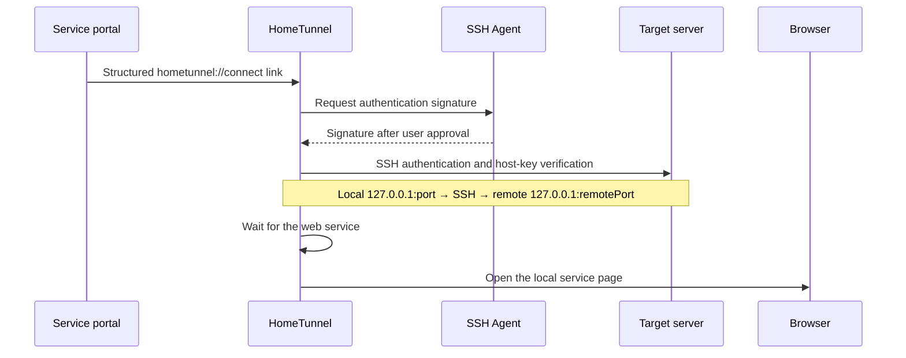

<div align="center">
  
  <h1>HomeTunnel</h1>
  <p><strong>Open private web services from your portal with one click.</strong></p>
  <p>A desktop SSH tunnel manager for Windows and macOS · SSH Agent authentication</p>
  <p>
    <a href="https://github.com/DongLiStudio/HomeTunnel/releases/latest"></a>
    <a href="https://github.com/DongLiStudio/HomeTunnel/actions/workflows/build.yml"></a>
    <a href="LICENSE"></a>
    
  </p>
  <p><a href="README.md">简体中文</a> · <strong>English</strong></p>
  <p><a href="#download-and-install">Download</a> · <a href="#quick-start">Quick start</a> · <a href="#portal-integration">Portal integration</a> · <a href="docs/security.md">Security model</a> · <a href="https://github.com/DongLiStudio/HomeTunnel/issues">Report an issue</a></p>
</div>

---

## Why HomeTunnel?

Private services can stay off the public web. Instead of opening a terminal, starting an SSH forwarding command and finding the local URL every time, click a service link in your portal.

HomeTunnel receives a structured link, authenticates through your existing SSH Agent, opens a tunnel, waits for the service and launches its local page. It is designed for home labs, self-hosted tools and administrative web services listening on a server's loopback interface.

> Early release: Windows installers are not publisher-signed. macOS builds are ad-hoc signed and not notarized. Read the release notes and follow your operating system's security guidance.

## Features

- **Portal integration** through the `hometunnel://` application scheme.
- **Agent-only authentication** with agents such as Bitwarden: no password storage, private-key export or password fallback.
- **Connection lifecycle**: open, renew, disconnect one or all, and automatic expiry.
- **Connection reuse**: repeated requests reuse owned tunnels; page changes do not require another SSH process.
- **Background operation** in the Windows tray or macOS menu bar, with configurable login startup.
- **Browser handoff** to the default browser or Edge, Chrome, Firefox and Safari, subject to platform and installation availability.
- **Local-service detection and diagnostics** for port conflicts, protocol registration and installation state.

## Download and install

| Platform | Package | Notes |
| --- | --- | --- |
| Windows x64 | [Download EXE](https://github.com/DongLiStudio/HomeTunnel/releases/latest/download/HomeTunnel-Windows-setup.exe) | Per-user installation; uses system OpenSSH |
| macOS Apple Silicon | [Download DMG](https://github.com/DongLiStudio/HomeTunnel/releases/latest/download/HomeTunnel-Mac.dmg) | macOS 13+; drag the app into Applications |

[Release notes and SHA256SUMS](https://github.com/DongLiStudio/HomeTunnel/releases/latest). Stable asset names support long-lived portal links; versioned names identify individual builds. Verify download integrity using the included checksums; checksums do not replace publisher signing.

Launch the installed application once to check protocol registration and login startup. Current release packages cover the platforms listed above; other platform or architecture installation experiences have not been accepted.

## Quick start

1. **Prepare server access**: authorize your public key, allow the required local SSH forwarding and start the target web service.
2. **Prepare your client**: make `ssh` available, enable and unlock your SSH Agent. Use `ssh-add -l` to list public identities; real authentication still requires Agent approval.
3. **Verify host trust** through a trusted console or administrator, then register the host in OpenSSH `known_hosts`. Unknown or changed host keys are rejected.
4. **Install and launch HomeTunnel**, then click a `hometunnel://connect?...` service link in your portal. Your browser may ask permission to open the application.
5. **Approve the Agent signature**. HomeTunnel waits for the service and opens its page. Renew or disconnect in the connection list; reopen the window from the tray or menu bar.

First verify the account, public key and host fingerprint using ordinary SSH. Signature confirmation policies belong to your Agent; HomeTunnel does not remove them.

## How it works



Both the local listener and remote forwarding destination are restricted to `127.0.0.1`. Application login, permissions and multi-factor authentication remain the target service's responsibility. HomeTunnel provides SSH local port forwarding, not VPN networking or NAT hole punching.

## Portal integration

Replace the example host, account and ports, then use the resulting URL as a portal card or button link. The example domain is illustrative.

```text
hometunnel://connect?host=server.example&user=alice&sshPort=22&port=18080&remotePort=8080&name=Private%20service&path=%2F&browser=default
```

| Parameter | Required | Meaning / default |
| --- | --- | --- |
| `host` | Yes | Server hostname or IP |
| `user` | Yes | SSH account |
| `sshPort` | Yes | SSH port |
| `port` | Yes | Local loopback listening port |
| `remotePort` | Yes | Remote loopback web-service port |
| `name` | No | Display name; defaults to host |
| `path` | No | Complete page path, optionally including a query; defaults to `/` |
| `browser` | No | `default`, `edge`, `chrome`, `firefox`, `safari`; defaults to `default` |
| `fingerprint` | No | Expected `SHA256:` SSH host fingerprint; must match a verified `known_hosts` record |

Ports must be in the range 1–65535. URL-encode parameter values; `URLSearchParams` can generate links. Unknown or duplicate parameters, command fields and external redirect paths are rejected. The only application scheme is `hometunnel://`; local secret path files are not used.

Complete service paths can be sensitive. Keep them in a protected portal and out of public issues.

## Security boundaries

- Structured connection parameters only; no arbitrary terminal command endpoint.
- Public-key SSH authentication, strict host verification, no Agent forwarding and no automatic trust of scanned host keys.
- Only owned SSH child processes are terminated; unrelated port listeners are left untouched.
- Links proceed without another manager approval dialog. **A deep link does not establish a trusted source**: verify the destination and Agent request.
- A compromised client, malicious portal or mistaken signature approval can still cause harm. HomeTunnel does not replace endpoint protection, application authorization or server isolation.

Read the [security model](docs/security.md) and [installed-client acceptance checklist](docs/acceptance.md).

## Troubleshooting

**A card does not open the application?** Launch the installed app, check protocol registration in installation diagnostics and confirm your browser permits external applications. Entering a scheme in the address bar does not guarantee dispatch.

**The Agent is unavailable or denies signing?** Enable and unlock it, check the target identity and approve the signature. Do not export a private key or enable password fallback.

**An unknown or changed host key?** Verify server identity through a trusted channel before updating `known_hosts`. Do not bypass host verification.

**A port conflict?** Check for an existing matching connection. If another application owns the port, choose a different local `port`; HomeTunnel will not terminate that application.

**Does the web service still need authentication?** Yes. SSH controls tunnel access; the application controls accounts and operations. Retain application authentication for shared or privileged services.

## Development

Built with **Rust, Tauri 2 and Vite / JavaScript**.

Install Rust stable, a Node.js version supported by Vite 7 (20.19+ or 22.12+) and the [Tauri platform prerequisites](https://tauri.app/start/prerequisites/).

```sh
npm ci
npm run tauri dev
```

Build and check:

```sh
npm run build
cargo test --manifest-path src-tauri/Cargo.toml
# Windows
npx tauri build --bundles nsis
# macOS, including the Chinese application-name configuration
npx tauri build --config src-tauri/tauri.macos.conf.json --bundles dmg
```

A compiled build is not an installed-client acceptance test. Verify protocol activation, background behavior, Agent authorization and browser handoff on the target platform.

## Contributing

Use [Issues](https://github.com/DongLiStudio/HomeTunnel/issues) for bugs and feature requests, or send a pull request for code and documentation improvements. Include your platform, application version, reproduction steps and sanitized errors. Add relevant regression checks for protocol or connection-lifecycle changes.

Report security vulnerabilities privately to the maintainer, using GitHub private vulnerability reporting where enabled. Never post credentials, private service URLs or unredacted logs publicly.

## License

[MIT](LICENSE) · Copyright © 2026 DongLiStudio

## Star History

<p align="center">
  <a href="https://www.star-history.com/#DongLiStudio/HomeTunnel&Date">
    <picture>
      <source media="(prefers-color-scheme: dark)" srcset="https://api.star-history.com/svg?repos=DongLiStudio/HomeTunnel&type=Date&theme=dark">
      <source media="(prefers-color-scheme: light)" srcset="https://api.star-history.com/svg?repos=DongLiStudio/HomeTunnel&type=Date">
      
    </picture>
  </a>
</p>
