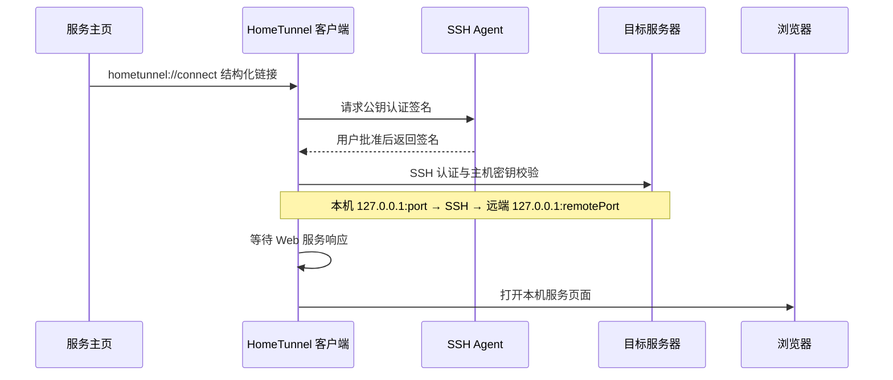

<div align="center">
  
  <h1>HomeTunnel · 家庭隧道</h1>
  <p><strong>从你的服务主页，一键连接私有 Web 服务。</strong></p>
  <p>Windows / macOS 桌面 SSH 隧道管理器 · 使用 SSH Agent 认证</p>
  <p>
    <a href="https://github.com/DongLiStudio/HomeTunnel/releases/latest"></a>
    <a href="https://github.com/DongLiStudio/HomeTunnel/actions/workflows/build.yml"></a>
    <a href="LICENSE"></a>
    
  </p>
  <p><strong>简体中文</strong> · <a href="README.en.md">English</a></p>
  <p><a href="#下载与安装">下载</a> · <a href="#快速开始">快速开始</a> · <a href="#接入你的服务主页">主页接入</a> · <a href="docs/security.md">安全模型</a> · <a href="https://github.com/DongLiStudio/HomeTunnel/issues">反馈问题</a></p>
</div>

---

## 为什么使用 HomeTunnel？

私有服务不必逐个开放公网端口，也不必每次手动启动终端、输入 SSH 转发命令，再寻找本机访问地址。

HomeTunnel 将这些步骤串成一次点击：服务主页提供结构化链接，桌面客户端使用现有 SSH Agent 建立隧道，等待服务响应，再打开本机页面。适合家庭实验室、自托管工具，以及只监听服务器回环地址的管理页面。

> 当前为早期版本。Windows 安装包尚无发行者签名；macOS 使用 ad-hoc 签名，尚未公证。请阅读发行说明并遵循操作系统的安全提示。

## 功能亮点

- **从主页打开服务**：通过 `hometunnel://` 链接唤起客户端，无需复制终端命令。
- **密钥留在 Agent**：使用 Bitwarden 等 SSH Agent；不保存密码，不导出私钥，不回退到密码认证。
- **管理连接生命周期**：打开、续期、断开单条连接或全部连接，到期自动关闭。
- **复用已有隧道**：重复请求复用客户端拥有的连接，更新页面路径无需另起 SSH 进程。
- **常驻后台**：Windows 托盘、macOS 菜单栏；可设置登录启动。
- **浏览器回跳**：支持默认浏览器及指定 Edge、Chrome、Firefox、Safari，实际可用性取决于平台与浏览器安装情况。
- **本机直连与诊断**：检测可直接访问的本机服务，报告端口冲突，检查协议注册和安装状态。

## 下载与安装

| 平台 | 安装包 | 说明 |
| --- | --- | --- |
| Windows x64 | [下载 EXE](https://github.com/DongLiStudio/HomeTunnel/releases/latest/download/HomeTunnel-Windows-setup.exe) | 当前用户安装，使用系统 OpenSSH 客户端 |
| macOS Apple Silicon | [下载 DMG](https://github.com/DongLiStudio/HomeTunnel/releases/latest/download/HomeTunnel-Mac.dmg) | macOS 13 及以上；将应用拖入“应用程序” |

[查看完整发行说明与 SHA256SUMS](https://github.com/DongLiStudio/HomeTunnel/releases/latest)。固定文件名用于主页的长期下载入口；版本化文件名用于识别特定构建。使用校验文件核对下载完整性；校验和不能替代发行者签名。

安装后启动一次应用，检查协议注册和登录启动设置。当前发行包仅覆盖上表平台；其他平台或架构的安装体验尚未验收。

## 快速开始

1. **准备 SSH 访问**：目标服务器接受你的公钥，允许所需的本地端口转发，并运行目标 Web 服务。
2. **准备客户端**：确认 `ssh` 可用，启用并解锁 SSH Agent。运行 `ssh-add -l` 查看公开身份；实际登录仍需 Agent 批准签名。
3. **建立主机信任**：通过可信控制台或管理员核验服务器主机指纹，再登记到 OpenSSH `known_hosts`。HomeTunnel 拒绝未知或变化的主机密钥。
4. **安装并启动 HomeTunnel**，然后点击服务主页中的 `hometunnel://connect?...` 链接；首次调用可能需要浏览器确认打开应用。
5. **批准 Agent 签名**：客户端等待服务可访问后打开页面。连接列表中可续期或断开；关闭窗口后仍可通过托盘或菜单栏打开客户端。

建议先用普通 SSH 独立验证目标账号、公钥和主机指纹。Agent 的签名确认策略由 Agent 自己管理，HomeTunnel 不会取消这些确认。

## 工作方式



隧道的本机监听和远端转发目标均限制为 `127.0.0.1`。目标服务原有的登录、权限与双因素认证仍由服务自身负责。HomeTunnel 是 SSH 本地端口转发客户端，不提供 VPN 组网或 NAT 打洞能力。

## 接入你的服务主页

将以下示例替换为你的目标主机、账号和端口，然后作为卡片或按钮链接使用。示例域名仅用于说明。

```text
hometunnel://connect?host=server.example&user=alice&sshPort=22&port=18080&remotePort=8080&name=Private%20service&path=%2F&browser=default
```

| 参数 | 必填 | 含义 / 默认值 |
| --- | --- | --- |
| `host` | 是 | 目标服务器域名或 IP |
| `user` | 是 | SSH 登录账号 |
| `sshPort` | 是 | SSH 端口 |
| `port` | 是 | 本机回环监听端口 |
| `remotePort` | 是 | 远端回环 Web 服务端口 |
| `name` | 否 | 显示名称；默认使用主机名 |
| `path` | 否 | 完整页面路径，可含查询参数；默认 `/` |
| `browser` | 否 | `default`、`edge`、`chrome`、`firefox`、`safari`；默认 `default` |
| `fingerprint` | 否 | 预期的 `SHA256:` SSH 主机指纹；必须匹配已核验的 `known_hosts` 记录 |

端口范围为 1–65535。参数值应进行 URL 编码；生成链接时可使用 `URLSearchParams`。未知参数、重复参数、命令字段和外部跳转路径会被拒绝。唯一协议为 `hometunnel://`，不使用本机私有路径文件。

完整服务路径可能含敏感信息，请放在受保护的主页中，不要将真实链接贴到公开 Issue。

## 安全边界

- 仅接受结构化连接参数，不接受任意终端命令。
- SSH 使用公钥认证、严格主机校验；不转发 Agent，不自动信任扫描到的主机密钥。
- 仅终止客户端自己创建的 SSH 子进程，不抢占或结束其他程序的端口监听。
- 链接不会额外触发管理器确认框；**深链接本身不证明来源可信**，请核对链接目标和 Agent 授权请求。
- 本机被控制、恶意入口或误批准签名仍可能造成风险。客户端不能替代系统防护、服务授权或服务器隔离。

详见 [安全模型（英文）](docs/security.md) 与 [安装验收清单（英文）](docs/acceptance.md)。

## 常见问题

**点击卡片没有打开应用？**

先启动已安装的客户端，检查安装诊断中的协议注册状态，并确认浏览器允许打开外部应用。只在地址栏输入协议名，不代表浏览器一定会分派给客户端。

**提示 Agent 不可用或拒绝签名？**

确认 Agent 已启用、解锁且包含目标身份，再批准本次签名。不要用导出私钥或启用密码回退来处理。

**主机密钥未知或发生变化？**

从可信渠道复核目标服务器身份，确认后再维护 `known_hosts`；不要跳过主机密钥校验。

**端口已被占用？**

检查连接列表是否已有同一隧道；若为其他程序占用，选择另一个本机 `port`。客户端不会终止无关进程。

**还需要给服务做登录认证吗？**

需要。SSH 控制隧道访问，服务自身负责网页账号及操作权限；尤其多人使用或高权限管理页面，应保留应用认证。

## 本地开发

技术栈：**Rust + Tauri 2 + Vite / JavaScript**。

准备 Rust stable、满足 Vite 7 要求的 Node.js（20.19+ 或 22.12+），以及 [Tauri 平台依赖](https://tauri.app/start/prerequisites/)。

```sh
npm ci
npm run tauri dev
```

构建与检查：

```sh
npm run build
cargo test --manifest-path src-tauri/Cargo.toml
# Windows
npx tauri build --bundles nsis
# macOS：包含中文应用名称配置
npx tauri build --config src-tauri/tauri.macos.conf.json --bundles dmg
```

编译通过不等于真实安装验收通过；协议调用、后台运行、Agent 授权和浏览器回跳应在目标平台上验证。

## 参与贡献

欢迎通过 [Issues](https://github.com/DongLiStudio/HomeTunnel/issues) 提交问题或功能建议，通过 Pull Request 改进代码和文档。问题报告请附平台、应用版本、复现步骤与脱敏错误信息；涉及协议或连接生命周期的修改，请补充相关回归验证。

发现安全问题时，请私下联系维护者；若仓库已启用 GitHub 私密漏洞报告，可使用该入口。不要在公开问题中提交凭据、真实私有服务链接或未脱敏日志。

## 许可证

[MIT](LICENSE) · Copyright © 2026 DongLiStudio
